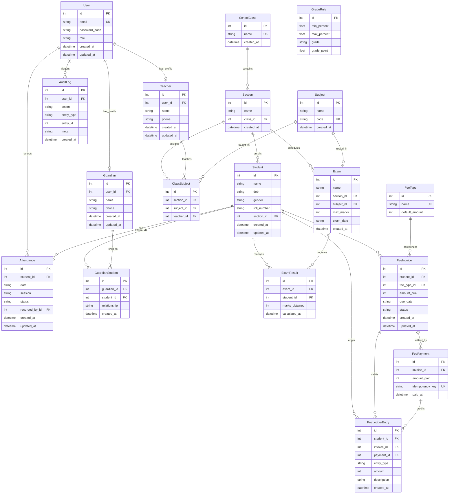

# School Management System

A full-stack web application for core school operations: academic administration, attendance, examinations and report cards, and fee management, with separate admin, teacher and guardian portals. Built for the Algions AI Labs Full-Stack Web Development assessment (assigned project: School Management System).

**Links:** [Live demo](https://school-management-system-psi-smoky.vercel.app/login) | [API docs](https://school-management-system-f6pr.onrender.com/api-docs) | [ER diagram](docs/er-diagram.md) | [Technical report](docs/technical-report.md) 

> Live demo data resets whenever the hosted server restarts, and the first request after idle can take up to a minute. If the live link is unavailable, the local setup below takes about 5 minutes.

## Quick start

```bash
git clone YOUR_REPO_URL
cd "School Management System"

cd server
npm install
cp .env.example .env        # set JWT_SECRET to a random string of 32+ characters
npm run db:migrate
npm run db:seed
npm run dev                 # API on http://localhost:4000, docs at /api-docs

# second terminal
cd client
npm install
npm run dev                 # app on http://localhost:5173
```

Requires Node.js 20+ and npm 10+. Run tests with `npm test` in `server/` (161 tests) and in `client/` (17 tests).

| Service | URL |
|---|---|
| Frontend | http://localhost:5173 |
| API | http://localhost:4000 |
| Swagger UI | http://localhost:4000/api-docs |
| Health check | http://localhost:4000/api/health |

## Demo credentials

Dummy credentials and synthetic data only. These accounts exist after `npm run db:seed`.

| Role | Email | Password | Scope |
|---|---|---|---|
| Admin | admin@school.demo | Admin@123 | Full access |
| Teacher 1 | teacher1@school.demo | Teacher@123 | Grade 9 Section A (Mathematics, Science) |
| Teacher 2 | teacher2@school.demo | Teacher@123 | Grade 10 A (Math, English) and Grade 10 B (History) |
| Guardian 1 | guardian1@school.demo | Guardian@123 | Rahul Singh (9A01) and Anjali Singh (9A02) |
| Guardian 2 | guardian2@school.demo | Guardian@123 | Priya Verma (10A01) and Karan Verma (10A02) |

## Requirements coverage

| Requirement from the brief | Implementation | Evidence |
|---|---|---|
| Academic administration | Admin CRUD for students, guardians, teachers, classes, sections, subjects, assignments and guardian links, with search, filters and pagination. Deleting a record with dependents returns 409. | `server/tests/adminAcademic.test.js` |
| Attendance | Unique constraint on (student, date, session). Duplicates are safely updated (upsert) with an audit entry. Section and student summaries. | `server/tests/attendance.test.js` |
| Exams, grading, report card | Grades are computed at read time from `GradeRule`. Report card is grouped per exam. Admin CRUD for grade rules. | `exam.test.js`, `gradeRule.test.js`, `gradeUtils.test.js` |
| Fees (simulated) | Ledger of DEBIT and CREDIT entries. Balance is computed from the ledger. Payment, ledger entry, status change and audit log run in one transaction. | `server/tests/fee.test.js` |
| Role-based access | Server-side JWT authentication, `requireRoles`, and ownership checks for teacher sections and guardian students. | `auth.test.js`, `teacherGuardianReads.test.js` |
| Reporting and privacy | Attendance, academic and fee reports scoped by role. Guardians get 404 for unlinked students. | `report.test.js` |
| Audit trail and dashboard | Append-only audit log with sensitive fields scrubbed. Admin dashboard. | `auditLog.test.js`, `dashboard.test.js` |
| Duplicate and conflict protection | `Idempotency-Key` header, unique key constraint, overpayment and invalid-state rejection, concurrent payment tests. | `fee.test.js` |
| Migrations, seed, diagram, API docs | Prisma migrations, `prisma/seed.js`, ER diagram, OpenAPI at `/api-docs`. | `server/prisma/`, `docs/` |

## Acceptance tests

| # | Acceptance test | Automated test | Manual check |
|---|---|---|---|
| 1 | Teacher accesses only assigned classes and records attendance | `attendance.test.js`: teacher on an unassigned section gets 403. `teacherGuardianReads.test.js`: teacher sees only assigned sections | Walkthrough 1 |
| 2 | Duplicate attendance is rejected or safely updated | `attendance.test.js`: duplicate submission updates one row, concurrent duplicates leave one row | Walkthrough 2 |
| 3 | Exam result calculated from configured rules | `gradeUtils.test.js`: boundary cases. `gradeRule.test.js`: editing a rule changes the grade | Walkthrough 3 |
| 4 | Guardian sees only the linked student | `teacherGuardianReads.test.js`: unlinked student profile and report card return 404 | Walkthrough 4 |
| 5 | Fee due and paid reconcile with the ledger | `fee.test.js`: independent reconciliation across paid, partial, unpaid and void invoices | Walkthrough 5 |

Exact test names are listed in [docs/technical-report.md](docs/technical-report.md).

## Tech stack

| Layer | Technology |
|---|---|
| Frontend | React 18, Vite, Tailwind CSS, React Router |
| Backend | Node.js, Express 4 (ES modules) |
| Database | SQLite with Prisma 5 (migrations and seed) |
| Auth and security | bcrypt, jsonwebtoken, cors, express-rate-limit |
| API docs | OpenAPI 3, swagger-ui-express |
| Testing | Vitest, Supertest |

## Architecture

A modular monolith with strict layering: routes, then controllers (HTTP only), then services (business rules and transactions), then Prisma.

```
client/            React app: api, auth, components, hooks, pages, utils
server/
  src/
    config/        validated environment variables
    db/            Prisma client
    middleware/    auth, RBAC, ownership checks, error handler, request logger
    routes/        one router per module
    controllers/   request parsing and responses only
    services/      business rules and transactions
    validators/    plain JavaScript validation functions
    utils/         logger, AppError, asyncHandler
  prisma/          schema, migrations, seed.js
  tests/           integration and unit tests
docs/              ER diagram, OpenAPI, technical report
```

Every error uses one shape: `{ "error": "CODE", "message": "...", "details": [] }`.

## Database schema

18 tables in SQLite, managed with Prisma migrations. Source of truth: [server/prisma/schema.prisma](server/prisma/schema.prisma). The Prisma model `Class` is shown as `SchoolClass` because `Class` is reserved in Mermaid.



Key constraints:

| Table | Constraint | Purpose |
|---|---|---|
| `attendance` | unique (student_id, date, session) | No duplicate attendance for the same student, date and session |
| `fee_payments` | unique `idempotency_key` | A retried payment cannot be recorded twice |
| `class_subjects` | unique (section_id, subject_id) | One teacher per subject in a section |
| `guardian_students` | unique (guardian_id, student_id) | No duplicate guardian links |
| `exam_results` | unique (exam_id, student_id) | One result per student per exam |
| `sections` | unique (class_id, name) | No two sections with the same name in a class |

Money fields are integer paise, dates are `YYYY-MM-DD` strings, and balances are computed from `fee_ledger_entries`. The same diagram is in [docs/er-diagram.md](docs/er-diagram.md).

## Key design decisions

- **Attendance upsert.** The database enforces uniqueness on (student, date, session). A duplicate submission updates the existing row and records the previous and new status in the audit log.
- **Money in integer paise.** No floating-point amounts. Balances are never stored; they are computed from ledger entries.
- **Payments.** One transaction re-reads the balance, rejects overpayment and payment on PAID or VOID invoices, then writes the payment, ledger entry, invoice status and audit log. The `Idempotency-Key` makes retries safe. A key reused by another user or for another invoice returns 409.
- **Void as a reversing entry.** Voiding writes a reversing CREDIT instead of deleting rows, and is allowed only when no payments exist.
- **Grades at read time.** Grades are not stored, so editing a grade rule updates report cards immediately. A base rule at 0% always exists.
- **404 for unlinked students.** A guardian cannot confirm that another student exists.
- **School timezone.** "Today" and the future-date check use `SCHOOL_TIMEZONE` (default Asia/Kolkata), not UTC.

## Security

- bcrypt-hashed passwords and JWTs with an 8 hour expiry
- Authorization enforced on the server for every protected route, never only in the UI
- Login rate limiting, helmet, and a configured CORS origin
- The same error message for an unknown email and a wrong password
- Audit log metadata scrubbed of passwords, hashes and tokens
- No secrets committed; only `.env.example` is tracked

## Environment variables

See [server/.env.example](server/.env.example).

| Variable | Required | Description |
|---|---|---|
| `DATABASE_URL` | Yes | SQLite path, for example `file:./dev.db` |
| `JWT_SECRET` | Yes | Random string, 32+ characters |
| `JWT_EXPIRES_IN` | No | Token lifetime, default `8h` |
| `PORT` | No | Default `4000` |
| `BCRYPT_ROUNDS` | No | Default `10` |
| `CORS_ORIGIN`, `CLIENT_ORIGIN` | No | Allowed frontend origin, default `http://localhost:5173` |
| `LOGIN_RATE_LIMIT_MAX` | No | Login attempts per window, default `30` |
| `LOGIN_RATE_LIMIT_WINDOW_MIN` | No | Window in minutes, default `15` |
| `SCHOOL_TIMEZONE` | No | Default `Asia/Kolkata` |
| `LOG_SILENT` | No | Set `true` to silence logs during tests |

## Scripts

| Location | Command | Purpose |
|---|---|---|
| server | `npm run dev` / `npm start` | Run the API |
| server | `npm test` / `npm run test:watch` | Backend tests (the test database `test.db` is reset automatically) |
| server | `npm run db:migrate` / `db:seed` / `db:reset` | Migrate, seed, reset the database |
| client | `npm run dev` / `npm run build` / `npm run preview` | Run, build or preview the frontend |
| client | `npm test` | Frontend unit tests |

Total automated tests: 178 (161 backend, 17 frontend).

## Demo walkthrough

Start both servers and open `http://localhost:5173`. 

1. **Teacher scope.** Log in as Teacher 1. Only Grade 9-A appears. Open Attendance, pick a session, click Mark All Present and save.
2. **Duplicate attendance.** Save the same date and session again. An update notice appears and the result shows 0 created, 3 updated. Log in as Admin and open Audit Logs to see the previous and new status.
3. **Grade rules.** As Guardian 1, open Rahul Singh's report card (Mid-Term Mathematics, 85/100). As Admin, open Exams and edit the grade rules so that 85% falls in a different band. Reload the report card and the grade changes with no change to the marks.
4. **Guardian privacy.** As Guardian 1, only Rahul and Anjali are listed. Change the student ID in the URL to a student linked to Guardian 2 and the app shows a not-found page (the API returns 404, not 403).
5. **Fees and ledger.** As Guardian 1, open Anjali's Tuition Fee invoice (₹5,000, UNPAID). Make a simulated partial payment (status PARTIAL), try to overpay (rejected), then pay the remainder (status PAID). As Admin, open Fee Invoices and compare the ledger with the totals.

## Deployment

Backend on Render and frontend on Vercel. See [docs/deployment-guide.md](docs/deployment-guide.md) for the build and start commands, environment variables, and the SPA rewrite configuration. The hosted database is reseeded on restart.

## Assumptions

- Attendance rate is (PRESENT + LATE) / total recorded sessions. Sessions with no attendance taken are not counted.
- Teacher access is by section through class-subject assignments. A teacher assigned to Grade 9-A cannot access Grade 9-B, and teachers get 403 on all fee routes.
- A guardian requesting a student not linked to them gets 404, not 403, to prevent ID enumeration.
- Payments are simulated. No real gateway, card or banking data exists.
- All records are synthetic.

## Known limitations

- **SQLite single writer.** Writes are serialized by a file-level lock. Lock conflicts (`SQLITE_BUSY`, `SQLITE_LOCKED`, `P2034`) return a clean 503. PostgreSQL with row-level locking is the production choice.
- **In-memory rate limiter.** Limits reset on restart and are not shared across instances.
- **JWT in localStorage.** The token is exposed to XSS. A production system would use a short-lived access token with a rotating refresh token in an httpOnly cookie.
- **No token revocation.** Tokens stay valid until they expire (8 hours).
- **Simulated payments only.** No external payment gateway.
- **Demo data resets** whenever the hosted service restarts.
- **No email or SMS notifications.** Confirmations are returned in API responses only.

## AI usage

I used Claude Sonnet 4.6 and 5.5 to generate code templates, write repetitive code (CRUD routes, validators, boilerplate) and generate test cases. For the frontend, I wrote the initial React code and logic with basic Tailwind styling, then used Gemini 3.8 Flash to improve the UI/UX on top of that code. I built the project in phases. After each phase I had the AI review the work against the brief and I also checked it myself by running the tests and trying the features. Libraries used: Express, Prisma, React, Vite, Tailwind CSS, TanStack Query, React Router, bcrypt, jsonwebtoken, helmet, cors, express-rate-limit, swagger-ui-express, Vitest, Supertest. See [docs/technical-report.md](docs/technical-report.md) for design details.