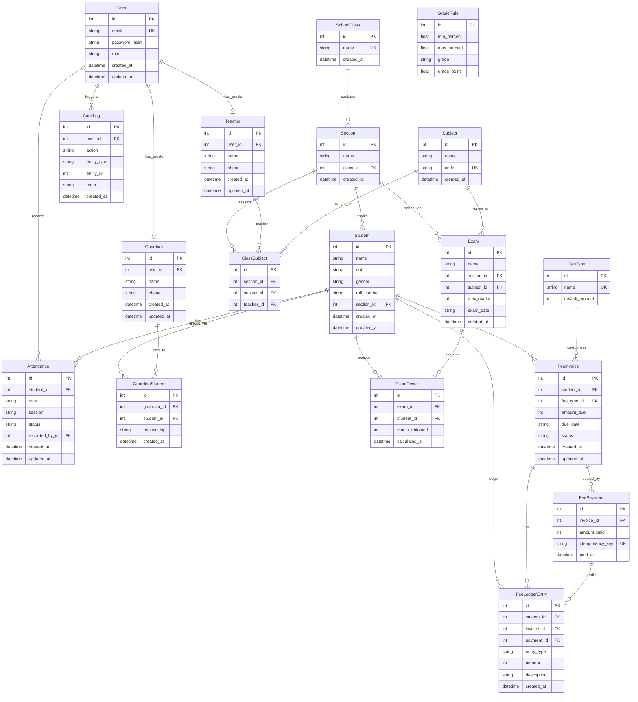

# School Management System – Entity-Relationship (ER) Diagram

This diagram represents the relational database schema defined in `server/prisma/schema.prisma` (SQLite engine).

> **Note:** The `Class` model is labeled as `SchoolClass` in this diagram because `Class` is a reserved keyword in Mermaid.

